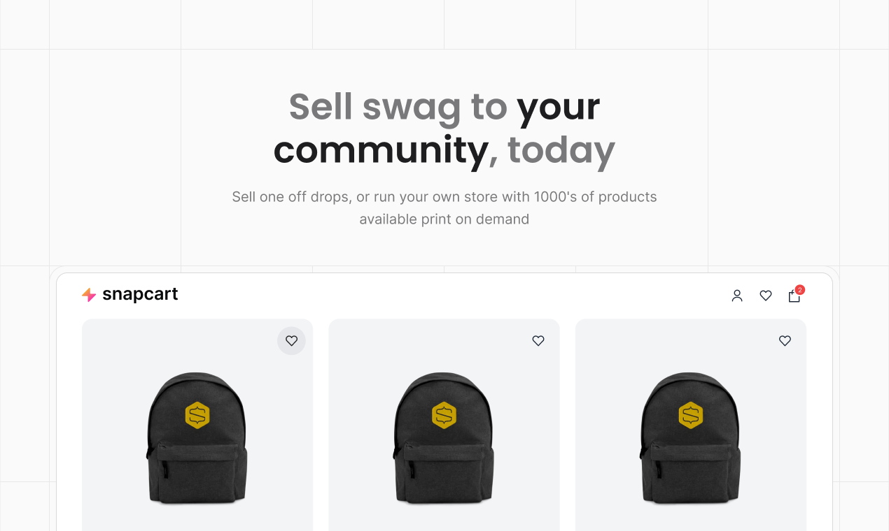

# Swag Boilerplate

A swag store that builds itself from your [Printful](https://www.printful.com) catalogue. Add a hoodie in Printful, rebuild, and it's on sale with Stripe checkout. Printful prints and ships each order once it's paid for, so there's no box of unsold T-shirts in the spare room.



[](https://vercel.com/new/clone?repository-url=https%3A%2F%2Fgithub.com%2Fnotrab%2Fswagboilerplate&env=PRINTFUL_API_TOKEN,STRIPE_SECRET_KEY,PUBLIC_STRIPE_PUBLISHABLE_KEY&envDescription=Printful%20and%20Stripe%20API%20keys&envLink=https%3A%2F%2Fgithub.com%2Fnotrab%2Fswagboilerplate%23environment-variables)
[](https://app.netlify.com/start/deploy?repository=https://github.com/notrab/swagboilerplate)

## What you get

- A storefront of your Printful products, 24 per page, with a product page for each one: mockup gallery, colour and size pickers, and prices that update as the customer chooses.
- A cart that remembers itself between visits, in a header popover and on its own page.
- Checkout with the Stripe Payment Element, so cards, Apple Pay, Google Pay and redirect-based methods all work. Saved addresses fill themselves in on the next visit.
- Live shipping rates and totals from Printful as the customer types their address.
- Orders sent to Printful only after Stripe confirms the payment, for the exact amount Printful priced.
- Order pages with progress and tracking links. If a payment fails, the customer can finish paying from the same page.
- Optional Markdown for any product: extra description, page title, search description and link preview image.
- `npm run setup`, which checks your Printful and Stripe keys as you paste them in and writes your `.env`.

<a href="https://www.buymeacoffee.com/notrab" target="_blank"></a>

## The services

| Service | What it does here |
| :-- | :-- |
| [Printful](https://www.printful.com) | Holds your products and prices, quotes shipping, then prints and ships each order |
| [Stripe](https://stripe.com) | Takes payments, and tells the store when an order is paid |
| [Astro](https://astro.build) | Builds the site, loads the catalogue from Printful at build time, and runs the server actions for checkout |
| [Alpine.js](https://alpinejs.dev) | Runs the cart and checkout in the browser |
| [Tailwind CSS](https://tailwindcss.com) | Styles everything, with three themes to start from |
| [Vercel](https://vercel.com), [Netlify](https://www.netlify.com) or any container host | Hosts it. The build picks the right adapter for each |

You'll need a Printful account and a Stripe account. Both are free to open; Printful charges you for each item it prints and Stripe takes a fee per payment.

## Set up your store

### 1. Printful

1. Under [Stores](https://www.printful.com/dashboard/store), create a store of type **Manual order platform / API**. The products API only works with this store type.
2. Add a product or two and set their retail prices. Customers pay these prices.
3. Create a private token at [developers.printful.com/tokens](https://developers.printful.com/tokens) with the `orders`, `sync_products` and `file_library` scopes. Private tokens expire, so put a reminder in your calendar.

### 2. Stripe

Copy your secret and publishable keys from [dashboard.stripe.com/apikeys](https://dashboard.stripe.com/apikeys). Use the test keys as you try things out, and keep both keys from the same mode.

### 3. Connect them

```sh
npm install
npm run setup
```

The setup script asks for each key, checks it against Printful or Stripe straight away, and picks your Printful store if your token can see several. It then writes `.env`, keeping a copy of the old one in `.env.backup`.

### 4. Choose how orders reach Printful

Each checkout creates a draft order in Printful, and Printful only prints an order once it's confirmed. You can confirm each one yourself, or add a Stripe webhook that confirms them as soon as they're paid.

Start by confirming orders yourself. You see every order before Printful bills you for it, and you'll soon know whether your prices, shipping and products look right. Add the webhook once you're happy to leave the store running on its own.

#### Confirming orders yourself

Leave `STRIPE_WEBHOOK_SECRET` unset. When an order comes in:

1. Find the payment in [Stripe's payments list](https://dashboard.stripe.com/payments) and check it says Succeeded. Its metadata has the Printful order ID under `printful_draft_order_id`.
2. Open that draft under Orders in your [Printful dashboard](https://www.printful.com/dashboard), check the items, address and total, and confirm it.

Only confirm drafts with a successful payment. A customer whose card is declined still leaves a draft behind. Until you confirm it, the customer's order page says "Your order is being processed".

#### Confirming orders automatically

Stripe tells the store about each payment through a webhook, and the store confirms the draft with Printful when it hears about it.

- Locally, run `stripe listen --forward-to localhost:4321/api/stripe-webhook` and use the `whsec_...` secret it prints.
- In production, add an endpoint for `https://your-domain/api/stripe-webhook` listening to `payment_intent.succeeded` at [dashboard.stripe.com/webhooks](https://dashboard.stripe.com/webhooks), and set its signing secret as `STRIPE_WEBHOOK_SECRET` with your host.

The webhook only confirms an order when the payment matches the draft exactly. Anything else is flagged on the payment in Stripe for you to review.

Run `npm run setup:check` any time to check the whole lot. It exits with an error when something's wrong, so it works in CI too. The same checklist prints whenever `astro dev` or `astro build` starts, and in dev the homepage shows it until your store has products.

## Deploy

The buttons at the top deploy to Vercel or Netlify. Add your keys as environment variables with the host. If you're confirming orders automatically, point the production Stripe webhook at your new address.

<details>
<summary><strong>Deploy to bunny.net Magic Containers</strong></summary>

[Magic Containers](https://bunny.net/magic-containers/) runs the store as a container on bunny.net's network, in the regions you pick. The repo has a `Dockerfile` that builds a standalone Node server, and a `bunny.jsonc` describing the app: one container listening on port 4321 behind a CDN endpoint with SSL.

The build loads your catalogue from Printful and bakes a few public values into the pages, so it reads your `.env`. The keys stay in the build stage, and the image you push only contains the built site. Set `SITE_URL` in `.env` to the store's public address first, since Magic Containers doesn't provide one the way Vercel and Netlify do.

You'll need [Docker](https://docs.docker.com/get-docker/) running and the [bunny CLI](https://www.npmjs.com/package/@bunny.net/cli):

```sh
npm install -g @bunny.net/cli
bunny login
bunny apps deploy --registry bunny
```

The first deploy builds the image, pushes it to the bunny.net registry, and creates the app from `bunny.jsonc`. The CLI fills in each environment variable from your `.env`, so the config file holds names and no values. The catalogue is baked into the image, so run the same command again after you change products in Printful. After changing a key, run `bunny apps env push .env`.

Change `regions` in `bunny.jsonc` to put the store nearer your customers. `bunny apps regions list` shows what's available.

If you're confirming orders automatically, point the Stripe webhook at `https://<your-store>/api/stripe-webhook` once the app has its address. Magic Containers can probe `/api/health` as a health check.

To try the image without deploying:

```sh
docker build --platform linux/amd64 -t swag-store .
docker run -p 4321:4321 --env-file .env swag-store
```

</details>

## Add and manage products

Everything about a product lives in Printful: the design, the colours and sizes, the mockups and the price. The store reads the catalogue when it builds, so the workflow is to make the change in Printful and rebuild.

To keep the store in step automatically, point a [Vercel deploy hook](https://vercel.com/docs/deploy-hooks) or a [Netlify build hook](https://docs.netlify.com/configure-builds/build-hooks/) at a schedule, say every night.

A few things happen on their own:

- A product that comes in one colour shows the colour as text, and only asks for the size. Products with nothing to choose go straight in the cart.
- Variants Printful marks as discontinued or out of stock disappear from the store.
- Products priced differently by size show "From £30.00" until the customer picks one.
- Each product page shows every distinct mockup Printful made for it.

### Product descriptions and metadata

Printful holds the product data. For anything extra, add a Markdown file to `src/content/products/`, named after the product's ID (the number in its URL). `/products/398660520` reads `398660520.md`:

```md
---
title: Embroidered Wool Snapback
description: A black wool-blend snapback with our logo embroidered on the front.
image: ./snapback-lifestyle.jpg
imageAlt: The snapback, worn on a windy day at the coast
---

A classic structured snapback with our logo stitched on the front.

## Details

- Wool-blend fabric
- Adjustable snap closure, one size fits most
```

The body appears under the add-to-cart button. Every frontmatter field is optional:

| Field | Used for | If you leave it out |
| :-- | :-- | :-- |
| `title` | The browser tab and link previews | The Printful product name |
| `description` | Search results and link previews | No description |
| `image` | Link previews in Slack, iMessage, X and the like | The Printful mockup |
| `imageAlt` | Describing the preview image | The product name |

Put the image next to the Markdown file. Astro checks it exists at build time and resizes it for previews, so start with something at least 1200 pixels wide. If a filename doesn't match a product, the build prints a warning telling you so. There's an example for the snapback in `src/content/products/398660520.md`.

## Share your products

A new product deserves a post or two. [Orbitwrite](https://orbitwrite.com) schedules and publishes to X, LinkedIn, Bluesky, Mastodon, Threads, Instagram, Facebook, TikTok, YouTube, Discord, Slack and Telegram from one calendar. Draft a post around the product link, adjust the wording for each network, and give it a slot in the week. The `image` and `description` from the Markdown file above are what most networks show when they unfurl the link.

## Make it yours

- Set `STORE_NAME`, `SUPPORT_EMAIL` and `LOGO_URL` or `LOGO_PATH`.
- Edit the homepage heading and intro in `src/content/home.md`. Words in `**bold**` stand out from the rest of the heading, and the frontmatter sets the homepage's description for search results and link previews. Delete the file to go straight to the products.
- Set `THEME` to `round` or `brutalist` for a different shape, or leave it unset for square corners. Colours live in `src/styles/global.css`.
- The privacy, refunds and terms pages are Markdown in `src/content/pages/`. Fill in the placeholders before you launch.
- Everything in `src/components` is yours to change.

## How checkout works

Prices always come from your Printful catalogue on the server. The browser sends variant IDs and quantities, and nothing else it sends can change what a customer pays.

1. The customer enters an address, and Printful quotes shipping for it.
2. Printful prices the order for the chosen shipping method, and the Stripe payment is updated to that total, so Apple Pay and Google Pay show the right amount.
3. When the customer clicks Pay, the store creates a draft Printful order and sets the payment to exactly what that draft costs. If the total has moved since the customer saw it, checkout stops and asks them to check it.
4. Stripe takes the payment. If you've set up the webhook, it confirms the draft with Printful only when the amount and currency match exactly, and flags anything else on the payment in Stripe for you to review. Without it, the draft waits for you to confirm it.

Customers who come back to an unpaid order can pay for it from the order page. That page can only take payment for the order; changing it needs a token that only the original checkout session holds.

## Limits worth knowing

- Printful allows 120 API requests a minute per store, shared between builds and customers. Builds wait for the limit, so a large catalogue takes longer to sync. Customers who hit it during a rush see a "we're very busy" message, and shipping quotes are cached for five minutes to spread the load.
- The catalogue only changes when you rebuild.
- With `PASS_THROUGH_VAT=true`, the store adds UK VAT at 20% to every order, wherever it ships. Read [the VAT guide](docs/VAT_GUIDE.md) before you turn it on.

## Environment variables

| Variable | Required | Description |
| :-- | :-- | :-- |
| `PRINTFUL_API_TOKEN` | Yes | Printful private token |
| `PRINTFUL_STORE_ID` | When your token can see several stores | `npm run setup` picks it for you |
| `STRIPE_SECRET_KEY` | Yes | `sk_test_...` or `sk_live_...` |
| `PUBLIC_STRIPE_PUBLISHABLE_KEY` | Yes | `pk_test_...` or `pk_live_...`, from the same mode as the secret key |
| `STRIPE_WEBHOOK_SECRET` | No | `whsec_...` from your webhook endpoint. Confirms paid orders in Printful automatically; without it, you confirm them yourself |
| `SITE_URL` | No | Your public address, for link previews. Vercel and Netlify provide it |
| `PASS_THROUGH_VAT` | No | `true` if you're VAT registered. See the [VAT guide](docs/VAT_GUIDE.md) |
| `UK_VAT_NUMBER` | No | Your VAT number, if registered |
| `STORE_NAME` | No | Shown in page titles and the footer (defaults to "Swag Store") |
| `SUPPORT_EMAIL` | No | Adds "Contact us" links |
| `THEME` | No | `round` or `brutalist` |
| `LOGO_URL` / `LOGO_PATH` | No | Your logo, as a URL or a path in `public/` |

## Development

```sh
npm install
npm run setup
npm run dev
stripe listen --forward-to localhost:4321/api/stripe-webhook   # in another terminal
```

```sh
npm test         # unit tests
npm run check    # type check
npm run build    # production build
```

Astro runs the dev server in the background. `npx astro dev logs` shows its output and `npx astro dev stop` stops it. Restart it after you change `.env`, since a running server keeps the values it started with.

Bug reports and feature ideas are welcome in the [issues](https://github.com/notrab/swagboilerplate/issues).
